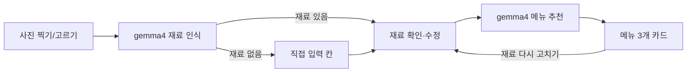

# 기말고사 기획 문서: 냉장고 사진으로 오늘 저녁 메뉴 정하기

- 학번: 202230302
- 이름: Kim kwanhyeak
- 과제: 15주차 기말고사, "스마트폰을 쓰면서 불편했던 점 해결하기"

## 0. 과제 조건 확인

강의서에 정해진 네 가지 조건과, 이 기획에서 각각을 어떻게 지키는지 정리한다.

| 과제 조건 | 이 기획에서 지키는 방법 |
| --- | --- |
| 결과물은 스마트폰에서 실행된다 (모바일 앱 또는 모바일 웹) | Flask로 모바일 웹을 만들고, 스마트폰 브라우저로 `http://PC주소:5000`에 접속해 쓴다 |
| 모델은 실습 서버의 gemma4를 쓴다 | `https://krchoi.com/gemma4/v1`의 `gemma4` 모델만 쓴다. 사진 인식과 메뉴 추천을 모두 gemma4가 한다 |
| 계획 → 단계별 테스트 → 최종 구현 순서로 진행한다 | 이 문서(계획)를 먼저 커밋한다. 6단계로 나누어 단계마다 테스트하고 결과를 `TEST.md`에 적은 뒤 다음 단계로 넘어간다 |
| `week15/`에 코드, 기획 문서, 진행 과정, 테스트 내용을 넣어 푸시한다 | `PLAN.md`, `PROGRESS.md`, `TEST.md`, `fridge/` 코드를 `week15/`에 두고 단계마다 커밋·푸시한다 |

채점 기준(기획 10점, 기능성 10점, 절차 10점)에 맞춰 이 문서는 1~2장에서 **기획**을, 3장에서 **기능성**을, 4~6장에서 **절차**를 다룬다.

---

## 1. 불편했던 점 (기획)

### 1.1 상황

- **언제**: 자취방에서 저녁을 직접 해 먹으려고 할 때 (주 3~4회, 주로 퇴근·하교 후 저녁 7시 무렵)
- **어디서**: 냉장고 앞에서 스마트폰을 든 채
- **무엇을 하다가**: 냉장고를 열어 남은 재료를 보고, 스마트폰 검색창이나 레시피 앱에 "계란 양파 요리" 같은 검색어를 칠 때

### 1.2 실제로 겪는 순서

1. 냉장고를 열어 재료를 확인한다. (예: 계란, 양파, 대파, 두부 반 모, 김치, 햄 조금)
2. 검색창에 재료를 2~3개씩 조합해 친다. 재료가 6개면 조합이 많아서 검색을 3~5번 반복한다.
3. 레시피를 열어 보면 내게 없는 재료(생크림, 굴소스, 다진 마늘 등)가 들어 있다. 열어 보기 전에는 알 수 없다.
4. 냉장고와 화면을 번갈아 보며 "이건 있나?"를 다시 확인한다.
5. 10~15분이 지나도 못 정하면 배달 앱을 켠다.

### 1.3 무엇이 불편한가

| 번호 | 불편한 점 | 왜 불편한가 |
| --- | --- | --- |
| P1 | 재료를 하나하나 타이핑해야 한다 | 냉장고 문을 연 채 한 손으로 입력하기 번거롭고, 재료가 많을수록 검색이 여러 번으로 늘어난다 |
| P2 | 레시피를 열어 봐야 못 만드는 줄 안다 | 검색 결과는 내 재료 기준이 아니라서 없는 재료가 꼭 섞여 있고, 하나씩 열어 확인하느라 시간이 든다 |
| P3 | 결국 결정을 못 한다 | 메뉴를 고르는 데 10분 넘게 걸리면 배달을 시키게 되고, 냉장고 재료는 유통기한이 지나 버려진다 |

---

## 2. 해결 방법 (기획)

냉장고(또는 장바구니) 사진을 한 장 찍어 올리면, gemma4가 사진 속 재료를 읽고
**지금 있는 재료만으로** 만들 수 있는 메뉴 3개를 추천한다.

### 2.1 불편 → 해결 대응

| 불편한 점 | 해결 방법 | 해당 기능 |
| --- | --- | --- |
| P1 재료 타이핑 | 사진 한 장을 찍으면 gemma4가 재료 목록을 만들어 준다 | F1, F2 |
| P1 잘못 읽은 재료 | 인식 결과를 체크박스로 보여 주고, 빼거나 직접 추가할 수 있다 | F3 |
| P2 없는 재료가 섞인 레시피 | 확정한 재료 목록을 기준으로만 추천하고, 메뉴마다 "부족한 재료"를 따로 보여 준다 | F4 |
| P3 결정을 못 함 | 결과를 3개로 줄이고 조리 시간을 함께 보여 줘 바로 고를 수 있게 한다 | F4 |

### 2.2 사용 흐름



### 2.3 이 방법이 불편을 해결하는지 확인하는 기준

- 사진을 올리고 메뉴 3개를 볼 때까지 **1분 이내**여야 한다 (기존 10~15분).
- 타이핑은 **0번**이 기본이고, 잘못 읽은 재료가 있을 때만 수정한다.
- 추천 메뉴의 주재료가 **확정한 재료 목록 안에** 있어야 한다. 소금, 간장, 설탕, 식용유 같은 기본 양념만 목록 밖에 있어도 된다.

---

## 3. 만들 기능 (기능성)

| 번호 | 기능 | 설명 | 완료 조건 |
| ---- | ---- | ---- | ---- |
| F1 | 재료 사진 올리기 | `<input type="file" accept="image/*" capture="environment">`로 카메라를 바로 열거나 앨범에서 고른다 | 스마트폰에서 버튼을 누르면 카메라가 열리고 찍은 사진이 서버로 전송된다 |
| F2 | 재료 인식 | 사진을 gemma4에 보내 재료 목록을 JSON으로 받는다 | 재료 사진에서 재료 이름 목록이 화면에 나온다 |
| F3 | 재료 수정 | 인식된 재료를 체크/해제하고, 빠진 재료를 입력 칸으로 추가한다 | 해제한 재료는 추천에 쓰이지 않고, 추가한 재료는 쓰인다 |
| F4 | 메뉴 추천 | 확정한 재료로 만들 수 있는 메뉴 3개를 받는다 | 메뉴 이름, 조리 시간, 사용 재료, 부족한 재료, 간단한 순서가 카드로 나온다 |
| F5 | 오류 처리 | 사진이 없거나, 재료를 못 읽거나, 모델 서버가 실패할 때 안내 문구를 보여 준다 | 어떤 경우에도 화면이 멈추거나 500 오류 페이지가 뜨지 않는다 |

### 3.1 구현 방식

- **화면**: Flask 모바일 웹, 한 페이지(`index.html`)에서 단계별로 내용이 바뀐다.
  - `<meta name="viewport" content="width=device-width, initial-scale=1">`
  - 버튼·입력창 높이 48px 이상, 글자 16px 이상 (12주차 기준)
- **모델 호출**: 브라우저가 아니라 Flask 서버에서 한다. 12주차 [`week12/split/app.py`](../week12/split/app.py)의 `ask(prompt, image_bytes, mime)`와 `parse_json(text)`를 그대로 가져다 쓴다.
- **라우트**

| 경로 | 메서드 | 하는 일 |
| --- | --- | --- |
| `/` | GET | 사진 올리기 화면 |
| `/` | POST, `action=recognize` | 사진을 받아 F2 실행, 재료 체크박스 화면 반환 |
| `/` | POST, `action=recommend` | 체크된 재료와 추가 재료로 F4 실행, 메뉴 카드 반환 |

### 3.2 프롬프트 초안

**재료 인식 (F2)**

```text
이 사진은 냉장고 안이나 장바구니, 식재료 사진이다. 사진에 보이는 식재료 이름을 한국어로 읽어라.
다른 설명 없이 아래 형식의 JSON으로만 답하라.
양념·소스 병은 라벨을 읽을 수 있을 때만 넣는다. 확실하지 않은 것은 넣지 않는다.
식재료가 보이지 않으면 {"ingredients": []} 로 답하라.
{"ingredients": ["계란", "양파"]}
```

**메뉴 추천 (F4)**

```text
내가 가진 재료: {재료 목록}
기본 양념(소금, 후추, 간장, 설탕, 식용유)은 있다고 가정한다.
위 재료만으로 만들 수 있는 집밥 메뉴 3개를 추천하라. 주재료는 반드시 내가 가진 재료 안에서 고른다.
다른 설명 없이 아래 형식의 JSON으로만 답하라.
{"menus": [{"name": "메뉴 이름", "minutes": 15, "uses": ["계란"], "missing": [], "steps": ["1단계", "2단계"]}]}
```

### 3.3 모델 응답 검증

모델 응답을 그대로 믿지 않고 서버에서 한 번 더 거른다.

- `parse_json` 결과가 `None`이면 같은 프롬프트로 **1번만** 다시 요청하고, 그래도 실패하면 F5 안내를 보여 준다.
- `ingredients`가 리스트가 아니거나 비어 있으면 "재료를 찾지 못했습니다"와 직접 입력 칸을 보여 준다.
- 추천 메뉴의 `uses` 중 내 재료 목록에 없는 것이 있으면 그 재료를 `missing`으로 옮긴다.

### 3.4 화면 디자인 (Claude Design)

화면은 **Claude Design**으로 시안을 먼저 만들고, 그중 하나를 골라 `index.html`로 구현한다.
시안은 iPhone 16 Pro 화면 크기(390×844)를 기준으로 5개를 만들었다.

- 시안 캔버스: https://claude.ai/artifact/5Loq299F714jdVZYCpfxbp (비공개, 공유 설정 후 열람 가능)

| 시안 | 이름 | 보여 주는 화면 | 특징 |
| --- | --- | --- | --- |
| A | 단계형 | 재료 확인 (F3) | 1·2·3단계 진행 막대, 체크박스 목록, 하단 큰 버튼. 흐름이 가장 분명하다 |
| B | 카드형 | 메뉴 추천 결과 (F4) | 메뉴마다 카드 하나, 조리 시간과 "지금 바로 가능 / 부족: ○○" 배지 |
| C | 대화형 | 전체 흐름 | 채팅처럼 사진을 보내면 재료 칩과 메뉴가 답장으로 온다 |
| D | 카메라 중심 (다크) | 사진 올리기 (F1) | 화면 대부분이 촬영 영역, 큰 셔터 버튼, 앨범·직접 입력 보조 버튼 |
| E | 한 화면 스크롤형 | 전체 흐름 | 사진·재료·추천 메뉴를 한 페이지에 순서대로 배치. Flask 한 페이지 구조와 가장 잘 맞는다 |

- 시안을 고른 이유와 실제 구현에서 바꾼 점은 `PROGRESS.md`에 적는다.
- 채점 기준상 화면 디자인은 평가하지 않으므로, 시안은 버튼 크기(48px 이상)·글자 크기(16px 이상)를 지키는 범위에서 단순하게 구현한다.

---

## 4. 단계와 단계별 확인 방법 (절차)

한 단계를 마치면 테스트하고, 결과를 `TEST.md`에 적고, 커밋한 뒤에 다음 단계로 넘어간다. 테스트를 통과하지 못하면 그 단계에서 고친다.

| 단계 | 할 일 | 확인 방법 (테스트) | 통과 기준 |
| ---- | ---- | ---- | ---- |
| 1 | Flask 뼈대: 사진 올리기 화면 (F1) | 크롬 개발자 도구 기기 모드(iPhone 12 Pro)에서 화면을 본다. 사진을 올리면 서버가 파일 크기를 출력하는지 본다 | 화면이 축소되지 않고, 버튼이 48px 이상이고, 서버가 사진을 받는다 |
| 2 | 재료 인식 (F2) | 테스트 사진 5장(아래 표)을 넣고 결과를 표로 기록한다. 실제 재료 대비 맞게 읽은 개수를 센다 | 재료 사진 3장에서 실제 재료의 70% 이상을 읽고, 재료 없는 사진 2장에서는 빈 목록이 나온다 |
| 3 | 재료 수정 (F3) | 잘못 인식된 재료 1개를 해제하고 새 재료 1개를 추가한 뒤 추천 요청에 실린 목록을 서버 로그로 확인한다 | 해제한 재료는 빠지고 추가한 재료는 들어가 있다 |
| 4 | 메뉴 추천 (F4) | 같은 재료로 3번 요청한다. 메뉴마다 주재료가 내 재료 안에 있는지 확인하고 `parse_json` 실패 횟수를 센다 | 9개 메뉴 모두 주재료가 목록 안에 있고, 재요청 후 최종 실패는 0번이다 |
| 5 | 오류 처리 (F5) | 아래 오류 상황 4가지를 일부러 만든다 | 4가지 모두 안내 문구가 나오고 다시 시도할 수 있다 |
| 6 | 실제 스마트폰 확인 | 6.2의 순서대로 스마트폰에서 `http://PC주소:5000`을 연다. 실제 냉장고를 카메라로 찍어 처음부터 끝까지 써 본다 | 스마트폰만으로 사진 → 재료 확인 → 메뉴 3개까지 1분 이내에 끝난다 |

### 4.1 2단계 테스트 사진

| 번호 | 사진 | 기대 결과 |
| --- | --- | --- |
| T1 | 냉장고 안 (재료 6개 이상) | 재료 대부분을 읽는다 |
| T2 | 장바구니·마트 봉투 | 재료 대부분을 읽는다 |
| T3 | 재료 1개 (예: 양파 하나) | 그 재료 1개 |
| T4 | 빈 냉장고 | 빈 목록 → 직접 입력 칸 |
| T5 | 풍경 사진 (식재료 아님) | 빈 목록 → 직접 입력 칸 |

### 4.2 5단계 오류 상황

| 번호 | 상황 | 만드는 방법 | 기대 화면 |
| --- | --- | --- | --- |
| E1 | 사진 없이 보내기 | 파일을 고르지 않고 버튼을 누른다 | "사진을 먼저 골라 주세요" |
| E2 | 식재료가 없는 사진 | T5 사진 사용 | "재료를 찾지 못했습니다" + 직접 입력 칸 |
| E3 | 모델이 JSON이 아닌 답을 줌 | 테스트용으로 `parse_json`이 `None`을 돌려주게 바꿔 본다 | 1번 재요청 후 안내 문구 |
| E4 | 모델 서버 응답 실패 | `base_url`을 잘못된 주소로 바꿔 실행한다 | "모델 서버에 연결하지 못했습니다. 잠시 뒤 다시 시도해 주세요" |

---

## 5. 진행 기록과 커밋 계획 (절차)

채점의 "절차" 항목은 문서와 커밋으로 확인하므로, 커밋 하나가 단계 하나에 대응하도록 한다.

| 순서 | 커밋 메시지 (예정) | 함께 올리는 문서 |
| --- | --- | --- |
| 0 | `15주차: 기말고사 기획 문서 작성` | `PLAN.md` |
| 1 | `15주차 1단계: Flask 사진 올리기 화면` | `PROGRESS.md`, `TEST.md` 1단계 |
| 2 | `15주차 2단계: gemma4 재료 인식` | `TEST.md` 2단계 (사진 5장 결과표) |
| 3 | `15주차 3단계: 재료 수정 기능` | `TEST.md` 3단계 |
| 4 | `15주차 4단계: 메뉴 추천` | `TEST.md` 4단계 (3회 반복 결과) |
| 5 | `15주차 5단계: 오류 처리` | `TEST.md` 5단계 (E1~E4 결과) |
| 6 | `15주차 6단계: 실제 스마트폰 확인` | `TEST.md` 6단계 (스마트폰 화면 캡처) |

- `PROGRESS.md`에는 단계마다 **한 일, 막힌 점, 고친 방법, 계획에서 바뀐 점**을 적는다.
- `TEST.md`에는 단계마다 **테스트 내용, 입력, 기대 결과, 실제 결과, 통과 여부**를 표로 적는다.
- 계획이 바뀌면 `PLAN.md`를 고치지 않고 `PROGRESS.md`에 바뀐 이유를 적는다. 처음 계획과 실제 진행을 비교할 수 있게 하기 위해서다.

---

## 6. 예상되는 어려움과 대응

| 어려움 | 대응 |
| --- | --- |
| 냉장고 사진이 어둡거나 재료가 겹쳐 잘 못 읽는다 | F3 재료 수정으로 보완한다. 2단계 결과가 나쁘면 프롬프트에 "보이는 것만, 확실한 것만"을 강조한다 |
| 스마트폰 사진 용량이 커서 업로드·응답이 느리다 | 2단계에서 응답 시간을 잰다. 느리면 브라우저나 서버에서 사진 크기를 줄인 뒤 보낸다 |
| 모델이 없는 재료를 쓰는 메뉴를 추천한다 | 3.3의 서버 검증으로 목록 밖 재료를 `missing`에 옮겨 표시한다 |
| 스마트폰에서 PC 서버에 접속이 안 된다 | 아래 6.2의 순서대로 하나씩 시도한다 |
| 실제 냉장고 사진에서 인식률이 낮다 | 사전 확인(6.1)은 단순한 그림으로만 했으므로, 2단계 T1~T5 결과를 보고 프롬프트를 고친다 |

### 6.1 사전 확인 결과 (기획 단계, 2026-11-17)

구현을 시작하기 전에 두 가지 조건이 지켜질 수 있는지 먼저 확인했다.

| 확인한 것 | 방법 | 결과 |
| --- | --- | --- |
| 실습 서버 접속 | `https://krchoi.com/gemma4/v1/models` 요청 | 정상 응답, 모델 `gemma4` |
| 글 요청 | 12주차 `ask()`로 "계란과 양파로 만들 요리" 질문 | "오믈렛" (약 1.6초) |
| 사진 요청 | 계란·양파·두부를 그린 테스트 그림 + F2 프롬프트 | `{"ingredients": ["계란", "양파", "두부"]}` (약 2.2초) |
| JSON 읽기 | 12주차 `parse_json()` | 위 응답을 정상으로 읽음 |
| PC 네트워크 | Windows 네트워크 설정 확인 | 유선(이더넷), 학교망 주소, 네트워크 프로필 "공용", Python 허용 방화벽 규칙 없음 |

→ gemma4는 사진을 받아 JSON으로 답하므로 F2, F4를 구현할 수 있다. 스마트폰 접속은 방화벽 설정이 필요하다.

### 6.2 스마트폰 접속 문제 대응 순서

스마트폰은 PC의 Flask에만 접속하고, gemma4는 PC의 Flask가 호출한다.

```
스마트폰 브라우저  →  PC의 Flask (0.0.0.0:5000)  →  krchoi.com gemma4
```

1. **방화벽 허용**: `app.run(host="0.0.0.0", port=5000)`으로 실행하고, Windows가 허용 여부를 물으면 "공용 네트워크"까지 체크해 허용한다. (관리자 권한 필요)
2. **학교망에서 접속**: 스마트폰에서 `http://PC주소:5000`을 연다. 학교망이 외부 접속을 막으면 3번으로 넘어간다.
3. **같은 공유기 사용**: 집 공유기에 PC와 스마트폰을 함께 연결하고 `ipconfig`로 확인한 내부 주소(`192.168.x.x`)로 접속한다.
4. **터널 사용**: 1~3이 모두 안 되면 ngrok이나 cloudflared로 임시 공개 주소를 만들어 스마트폰에서 연다.

어떤 방법으로 접속했는지는 6단계 테스트 결과와 함께 `TEST.md`에 적는다.

### 6.3 아이폰 16 Pro로 6단계 확인하는 방법

사용 기기는 **iPhone 16 Pro**이고, 앱 설치 없이 기본 브라우저인 **Safari**로 확인한다.

1. **같은 네트워크 연결**: PC와 아이폰을 같은 공유기에 연결한다. 아이폰이 셀룰러(LTE/5G)로만 연결돼 있으면 접속할 수 없으므로 설정 → Wi-Fi를 확인한다. 학교 와이파이에서 안 되면 6.2의 3번, 4번 방법을 쓴다.
2. **PC 주소 확인**: PC의 PowerShell에서 `ipconfig`를 실행해 `IPv4 주소`(예: `192.168.0.15`)를 찾는다.
3. **서버 실행**: `python week15/fridge/app.py`로 서버를 켠다. Windows 방화벽 창이 뜨면 개인·공용 네트워크를 모두 체크하고 "허용"을 누른다.
4. **Safari로 접속**: 아이폰 Safari 주소창에 `http://192.168.0.15:5000`처럼 입력한다. `https`가 아니라 `http`이고, 끝의 `:5000`을 빼지 않는다. 연결이 안 되면 1~3번을 다시 확인한다.
5. **카메라로 찍어 올리기**: 사진 버튼을 누르면 후면 카메라가 바로 열린다. 찍고 "사진 사용" → "재료 인식"을 누른다. 처음에 Safari가 카메라 권한을 물으면 "허용"한다.
6. **(선택) 홈 화면에 추가**: Safari 공유 버튼 → "홈 화면에 추가"로 앱처럼 아이콘에서 바로 연다.

F1의 사진 입력은 아이폰에서 다음과 같이 동작한다.

| HTML 코드 | 아이폰에서 버튼을 눌렀을 때 |
| --- | --- |
| `<input type="file" accept="image/*" capture="environment">` | 후면 카메라가 바로 열림 (이 기획에서 쓰는 방식) |
| `<input type="file" accept="image/*">` | "사진 보관함 / 사진 찍기 / 파일 선택" 메뉴가 뜸 |

아이폰이라서 주의할 점

- **사진 형식**: 아이폰은 사진을 HEIC로 저장하지만, Safari가 업로드할 때 보통 JPEG로 바꿔 보낸다. 서버에 도착한 형식은 1단계에서 서버 로그로 확인한다.
- **사진 용량**: 한 장에 수 MB라서 응답이 느릴 수 있다. 2단계에서 응답 시간을 재고, 느리면 서버에서 크기를 줄여 gemma4에 보낸다.

6단계 `TEST.md`에 남길 것

- 기기·브라우저: iPhone 16 Pro, Safari
- 접속 방법과 주소 (예: 집 공유기, `http://192.168.0.15:5000`)
- 카메라가 바로 열렸는지, 사진 → 재료 확인 → 메뉴 3개까지 걸린 시간
- 아이폰 화면 캡처 1~2장 (측면 버튼 + 볼륨 업 버튼 동시에 누르기)

---

## 7. 제출 폴더 구성 (예정)

```
week15/
├── PLAN.md        이 기획 문서 (계획)
├── PROGRESS.md    단계별 진행 기록
├── TEST.md        단계별 테스트 결과
├── test_images/   2단계 테스트 사진 T1~T5
└── fridge/
    ├── app.py
    └── templates/index.html
```
